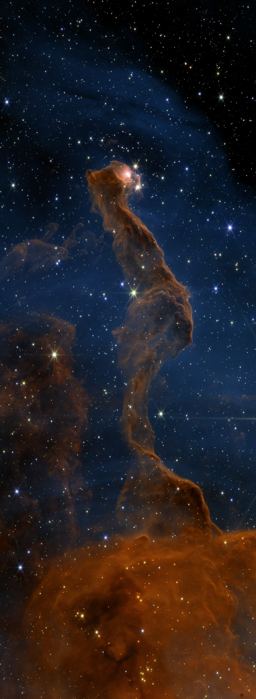
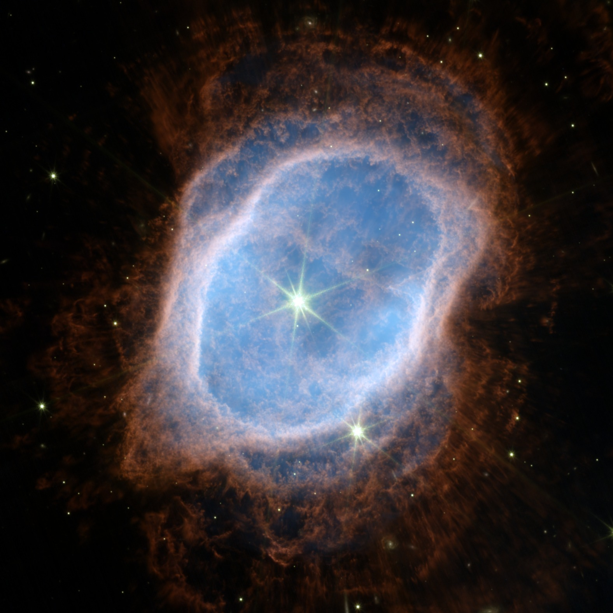
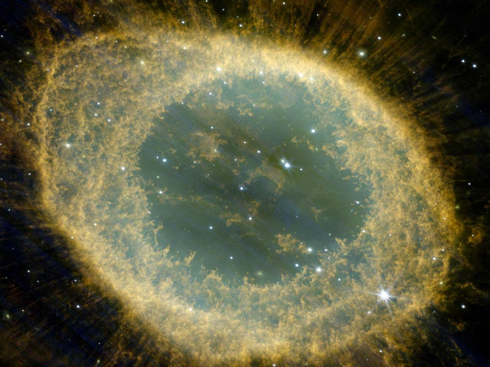
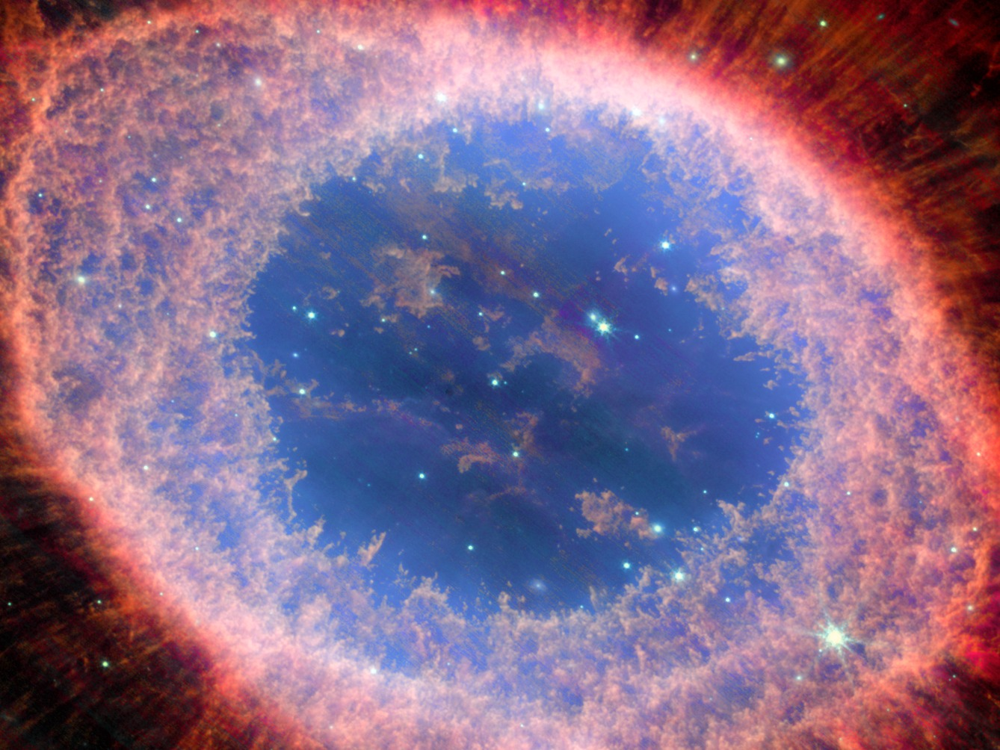
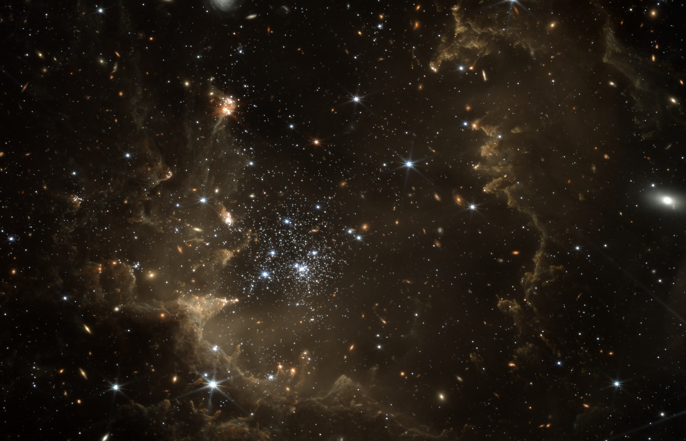
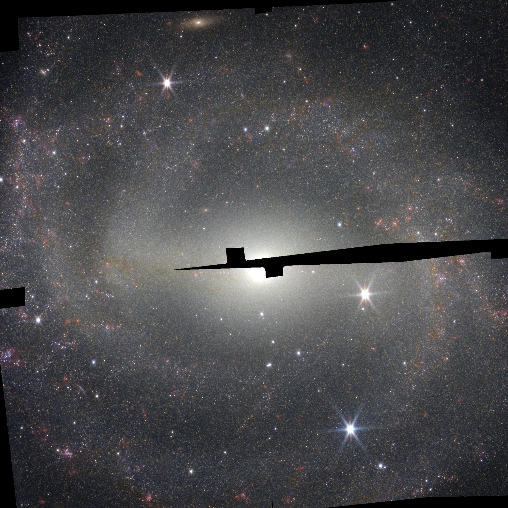

# astro-pipeline

A transparent, reproducible Python pipeline that turns public JWST data from the
[MAST archive](https://mast.stsci.edu) into colour images:

find and download data → bring all filters onto a common grid → stretch the brightness →
assign colours → export with a caption that documents every step.

A hobby project, inspired by amateur processing of published JWST data. Every decision
(and every mistake that was found and fixed) is documented, so that each image can be
recomputed from the data and the parameter files alone.

<p align="center">
  <br>
  <em>Star-forming pillar in the South Pillars region of the Carina Nebula (programme 12591, data released October 2026) – made by the script with default
  parameters (<code>python -m astropipe.explore --program 12591</code>), no manual steps: grid rotated to the
  observed field, crop = largest rectangle inside it. NIRCam, 6 filters, colours in wavelength order.</em>
</p>

| NGC 3132 – Southern Ring Nebula | NGC 6720 – Ring Nebula | NGC 6720 – NIRCam + MIRI |
|---|---|---|
|  |  |  |
| NIRCam, 6 filters, colours grouped by physical origin | NIRCam, 4 filters, destriped | NIRCam + MIRI, ionisation layers |

| NGC 602 – young star cluster in the Small Magellanic Cloud | NGC 5643 – two observations combined |
|---|---|
|  |  |
| Cluster and its ring of gas and dust, ~200,000 light-years away; most small orange ellipses are background galaxies. NIRCam, 6 filters, 16 GB of data, made by the script without manual steps (grid rotated to the field) | NIRCam, 3 filters; the black wedge is sky not covered by either observation |

Each image has a caption file next to it (`*_caption.md`) with the filter → colour table,
the processing steps and the credits.

## What the pipeline does

| Step | Notebook | In the package |
|---|---|---|
| Setup check | `00_setup_check` | – |
| Find and download stage-3 images (`_i2d.fits`) | `01_query_download` | `astropipe.mast` |
| Understand FITS: extensions, units, WCS | `02_inspect_fits` | – |
| Registration onto a common north-up grid | `03_reproject` | `astropipe.registration` |
| Background from empty sky boxes, asinh stretch | `04_stretch` | `astropipe.stretch` |
| Colour: one hue per filter, additive mixing | `05_color` | `astropipe.color` |
| Crop, orientation check, export + caption | `06_export` | `astropipe.export` |
| Regression test of the package | `07_regression_ngc3132` | – |
| Second object, destriping | `08_ngc6720`, `08a`, `08b` | `astropipe.clean` |
| NIRCam + MIRI | `09_miri_ngc6720`, `09a_…` | – |
| Whole pipeline from a TOML config | `10_run_configs` | `astropipe.run` |
| Explorer mode: random suitable data set | `11_explore` | `astropipe.explore` |

The notebooks explain *what* is done and *why* (with analogies to fluorescence
microscopy, where I come from). The package in `src/astropipe/` contains the same logic
as reusable functions.

## Quick start

```bash
conda env create -f environment.yml
conda activate astro-pipeline
pip install -e . --no-deps

# reproduce an image from its configuration (downloads ~2.5 GB of data on the first run)
python -m astropipe.run configs/ngc3132.toml

# explorer mode: pick a random suitable public NIRCam data set and make a preview
python -m astropipe.explore --seed 7

# or a specific programme (e.g. newly released data)
python -m astropipe.explore --program 12591 --max-gb 7
```

Results: web JPEG + caption in `output/runs/`, full-resolution TIFF/PNG in
`output/full_res/` (not in git), all values used in `params/<name>_run.json`.
Each run also writes an overview of the whole field (`*_overview.jpg`) with the crop marked.

## Honest notes

- **The colours are an assignment, not "true" colours.** JWST records infrared light.
  Each caption says whether the colours follow wavelength order (chromatic) or were
  chosen freely (e.g. grouped by physical origin).
- **Aesthetic choices are labelled as such**, e.g. each filter is normalised to its own
  white point, and MIRI images are upsampled to the NIRCam grid (a version with matched
  sharpness is provided for comparison).
- **Orientation:** classic configurations are north up, east left. Explorer runs rotate the grid so that the
  observed field lies straight (a tilted field otherwise loses up to ~80 % to the crop); the caption then states
  where north points. Every run also exports the whole observed field (`*_field_web.jpg`) next to the crop.
- **Known limitations:** readout stripes ("1/f noise") are corrected on the combined
  i2d images, which is an approximation – residual stripes remain in some fields; a clean
  correction would act on the single exposures. Detector gaps that no observation covers
  stay black.

## Repository layout

| Path | Content |
|---|---|
| `notebooks/` | one notebook per step, with "What / Why / Result / Conclusion" cells |
| `src/astropipe/` | the Python package |
| `configs/` | TOML configuration per image (`configs/explore/` for explorer runs) |
| `params/` | all parameters and measured values per image (JSON) |
| `output/` | web images, previews and captions |
| `data/` | downloaded FITS files and intermediate results (not in git) |
| `PLAN.md`, `docs/worklog.md` | project plan, decisions with reasons, and work log – kept in **German** as my working record |

## Data and credits

The images are based on observations made with the NASA/ESA/CSA James Webb Space
Telescope. The data were obtained from the Mikulski Archive for Space Telescopes (MAST)
at the Space Telescope Science Institute, which is operated by the Association of
Universities for Research in Astronomy, Inc., under NASA contract NAS 5-03127 for JWST.

Programmes used: 2733 (Early Release Observations, NGC 3132), 1558 (PI M. Barlow,
NGC 6720), 1685 (NGC 5643), plus the fields found in explorer mode (programme numbers
in the respective captions and reports). Credit line on the images:
*NASA, ESA, CSA, STScI*; processing: Tritium13. The images are my own processing and not
official products of NASA, ESA, CSA or STScI.

Filter contents: JWST NIRCam filter documentation; Pontoppidan et al. 2022
(arXiv:2207.13067) for NGC 3132; Wesson et al. 2024 (arXiv:2308.09027) for NGC 6720.

Software: Astropy, astroquery, reproject, NumPy, SciPy, Matplotlib, Pillow, tifffile.

## License

The code is released under the [MIT License](LICENSE). The JWST data and the credit
requirements above are not covered by this license.
